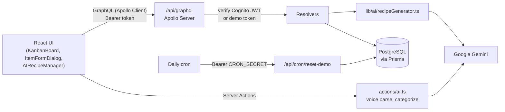

# Pantry AI

**A mobile-first pantry manager with an AI chef built in.** Track what you need to buy, what you have, and what you've used up. When you can't decide what to cook, pick a few ingredients and let Gemini come up with a recipe.

🔗 **Live demo:** [pantry-ai-eta.vercel.app](https://pantry-ai-eta.vercel.app/). Click **Try Demo** on the login page; no account needed. The demo pantry resets to sample data every day.

---

## What it does

Pantry AI is for people who cook at home and want to keep careful track of their ingredients: how much they have and when it expires. You mostly use it one-handed on a phone, in the kitchen or at the supermarket. Managing items comes first. The AI is a fun extra that solves "what's for dinner?" and cuts down on food waste.

### Pantry board

- **Three lists:** `To Buy` → `In Pantry` → `Consumed`. Every item moves through this lifecycle.
- **Partial moves:** move just 2 of your 12 eggs to _Consumed_. When identical items (same name, unit, and expiry) land in the same list, they merge automatically, inside a Prisma `$transaction`.
- **Expiry warnings:** cards in the pantry are highlighted when an item is expiring soon or has expired.
- **Quick re-buy:** one tap sends a consumed item back to _To Buy_.
- **Category filter:** 7 food categories (Produce, Dairy, Meat, Pantry, Frozen, Beverage, Other), each with its own icon and color.
- **Phone-friendly:** swipe left or right to switch lists, with item counts in the sticky tabs and a thumb-reachable bottom navigation bar. Layouts are checked at 320px, 375px, and desktop widths.

### AI features (Google Gemini `gemini-3.1-flash-lite`)

| Feature                  | How it works                                                                                                                                                                                                                                      |
| ------------------------ | ------------------------------------------------------------------------------------------------------------------------------------------------------------------------------------------------------------------------------------------------- |
| **Voice input**          | Say something like _"three hundred grams of pork, expires next Wednesday"_ (English or Chinese). The browser's Web Speech API turns it into text, and Gemini extracts the name, quantity, category, and an exact expiry date.                     |
| **Auto-categorize**      | One tap and Gemini picks a category from the item name. If anything goes wrong, it falls back to `OTHER`.                                                                                                                                         |
| **Inspire Me (AI Chef)** | Tick some **must-use ingredients**, from any list, and Gemini writes a recipe around them, using other pantry items as supporting ingredients when they help. **Regenerate** for a different dish; **Save Recipe** to keep it under _My Recipes_. |
| **Nutrition card**       | Every generated recipe comes with calories, macros (protein / carbs / fat / fiber), dietary tags, and healthier-swap tips.                                                                                                                        |

All AI output is **structured**: Gemini is called with a `responseSchema`, and the result is checked again with Zod before it reaches the UI. Recipe generation retries up to 3 times with backoff, so a malformed or failed response never crashes the page.

---

## Tech stack

| Layer      | Technology                                                                                          |
| ---------- | --------------------------------------------------------------------------------------------------- |
| Frontend   | Next.js 16 (App Router), React 19, Tailwind CSS v4, shadcn/ui on Base UI, lucide-react              |
| Data layer | Apollo Client 4 ↔ Apollo Server 5 (GraphQL, schema-first) served from a Next.js route handler       |
| Database   | PostgreSQL (Neon serverless in production, Docker locally) via Prisma ORM                           |
| AI         | Google GenAI SDK (`@google/genai`) with structured output, called from Server Actions and resolvers |
| Auth       | AWS Cognito (Amplify v6 on the client, `aws-jwt-verify` on the server) plus a public demo mode      |
| Quality    | TypeScript, Zod, Vitest, ESLint, Prettier, Husky + lint-staged pre-commit hooks                     |
| Hosting    | Vercel                                                                                              |

## Architecture



- **Auth:** each request carries a token. The GraphQL context verifies the Cognito ID token locally (no call to AWS), or maps the demo token to the shared `public-demo-user`. Resolvers only ever read or write the current user's rows.
- **Deep modules:** each feature keeps its own state, GraphQL operations, and UI together (for example `AIRecipeManager`). `page.tsx` only composes them.
- **Thin Server Actions:** `'use server'` files export only async functions. Zod schemas and constants live in `src/lib/`.

## Project structure

```text
src/
├── app/
│   ├── page.tsx                  # Main board (composition only)
│   ├── login/page.tsx            # Cognito sign-in / sign-up / Try Demo
│   ├── actions/ai.ts             # Server Actions: voice parsing, auto-categorize
│   └── api/
│       ├── graphql/route.ts      # Apollo Server + JWT verification
│       └── cron/reset-demo/      # Resets the demo account's data
├── components/
│   ├── pantry/                   # KanbanBoard, PantryItemCard, ItemFormDialog,
│   │                             # AIRecipeManager, RecipeNutritionCard, nav bars
│   ├── providers/                # ApolloProvider, AuthProvider (route guard)
│   └── ui/                       # shadcn/ui primitives
├── graphql/                      # typeDefs + resolvers
├── hooks/                        # usePantry (GraphQL data), useSwipe
└── lib/
    ├── ai/recipeGenerator.ts     # Prompt, response schema, retry loop
    ├── schemas/                  # Shared Zod schemas
    └── constants/categories.ts   # Category taxonomy (icons, colors, examples)
prisma/schema.prisma              # User, PantryItem, Recipe models
```

---

## Running locally

### Prerequisites

- **Node.js 20.9+** (required by Next.js 16) and npm
- **PostgreSQL**: the included `docker-compose.yml` starts one for you (requires Docker), or use any Postgres such as a free [Neon](https://neon.tech) database
- **Gemini API key** (free): get one at [Google AI Studio](https://aistudio.google.com/apikey). Optional, but without it the AI features are disabled.
- **AWS Cognito user pool**: _optional_. You only need it for real email sign-up and sign-in. **Try Demo** works without it.

### 1. Clone and install

```bash
git clone https://github.com/albert0891/pantry-ai.git
cd pantry-ai
npm install
```

`npm install` also runs `prisma generate` (via Prisma's postinstall hook) and sets up the Husky git hooks.

### 2. Start a database

```bash
docker compose up -d
```

This starts Postgres 15 on `localhost:5432` with user `postgres`, password `password`, and database `pantry_db`. The default `DATABASE_URL` in `.env.example` already points to it.

### 3. Configure environment variables

```bash
cp .env.example .env
```

Then open `.env` and fill in:

| Variable                                                                                                  | Required?         | Notes                                                                                                                                                                   |
| --------------------------------------------------------------------------------------------------------- | ----------------- | ----------------------------------------------------------------------------------------------------------------------------------------------------------------------- |
| `DATABASE_URL`                                                                                            | Yes               | Already set for the Docker database; replace it if you use your own Postgres.                                                                                           |
| `GEMINI_API_KEY`                                                                                          | For AI features   | Without it: auto-categorize returns `OTHER`, while voice input and Inspire Me show an error. Everything else still works.                                               |
| `NEXT_PUBLIC_AWS_REGION`<br/>`NEXT_PUBLIC_AWS_USER_POOL_ID`<br/>`NEXT_PUBLIC_AWS_USER_POOL_WEB_CLIENT_ID` | For real accounts | **Keep the placeholder values if you only want demo mode.** The server checks the pool ID format at startup, so deleting these lines breaks the API, even in demo mode. |
| `CRON_SECRET`                                                                                             | Production only   | The demo-reset endpoint checks it only when `NODE_ENV=production`.                                                                                                      |

> Use `.env` rather than `.env.local`: the Prisma CLI only reads `.env`, and Next.js reads both.

### 4. Create the database tables

```bash
npx prisma db push
```

### 5. Run the app

```bash
npm run dev
```

Open [http://localhost:3000](http://localhost:3000) and click **Try Demo**.

**Optional: load the sample pantry.** In development the reset endpoint needs no secret, so with the dev server running you can load the same sample items the live demo uses:

```bash
curl http://localhost:3000/api/cron/reset-demo
```

Tip: the app is designed for phones, so open your browser's device toolbar (375px wide) to see it the way it's meant to be used.

## Scripts

| Command                           | What it does                                                                        |
| --------------------------------- | ----------------------------------------------------------------------------------- |
| `npm run dev`                     | Start the dev server (Turbopack)                                                    |
| `npm run build`                   | `prisma generate` + production build (uses Webpack; see note below)                 |
| `npm start`                       | Serve the production build                                                          |
| `npm test` / `npm run test:watch` | Vitest unit tests (AI parsing, Zod schemas, category taxonomy). No database needed. |
| `npm run lint`                    | ESLint                                                                              |
| `npx tsc --noEmit`                | Type check                                                                          |

The pre-commit hook runs Prettier on staged files, then `npm test` and `npm run build`.

> **Why `--webpack`?** Next.js 16's Turbopack production build has an upstream bug parsing some Google Fonts URLs, so production builds use Webpack for now.

## Deploying (Vercel + Neon)

1. Create a Neon Postgres database and run `npx prisma db push` against it.
2. Import the repo into Vercel and add the same environment variables. Set `CRON_SECRET` to a long random string.
3. To reset the public demo every day, have a cron service (for example cron-job.org) call `GET /api/cron/reset-demo` with the header `Authorization: Bearer <CRON_SECRET>`.

## Further reading

- [`PRODUCT.md`](PRODUCT.md): who it's for and the product principles
- [`DESIGN.md`](DESIGN.md): visual system and mobile layout specs
- [`CONTEXT.md`](CONTEXT.md): domain glossary (BoardState, must-use ingredient, …)
- [`docs/dev-log.md`](docs/dev-log.md): dated development history

## License

MIT
